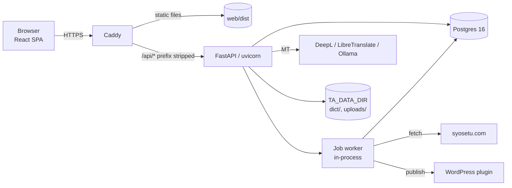

# Architecture

ta-web is a web port of the [Translation Assistant](https://github.com/Punllarena/Translation-Assistant)
PySide6 desktop app. The desktop repo is the reference: its Qt-free modules are ported near-verbatim
into `api/core/` and `api/mt/`, and its `db.py` schema is the reference for the SQLAlchemy models.
The full design is in the [port spec](superpowers/specs/2026-10-10-web-app-port-design.md); each
phase has a plan in [`superpowers/plans/`](superpowers/plans/).

## System overview



- **Caddy** serves the SPA and fronts the API under `/api`, so the API's paths and the SPA's routes
  never collide on a refresh. It also owns TLS and request body caps.
- **The API** is FastAPI with SQLAlchemy 2 and Alembic. It is never published on the host directly.
- **Jobs** (syosetu fetch, batch publish, illustrations, dictionary download, `ta.db` import) run in
  a worker inside the API process. Progress streams over SSE at `/jobs/{id}/events`.
- **MT backends** stream through `GET /mt/stream` (SSE); results are cached in `mt_cache`.

## Directory layout

```text
api/
  main.py, routing.py, deps.py   app factory, commit boundary, auth and tenancy helpers
  routers/                       one module per resource (thin HTTP layer)
  schemas/                       Pydantic request/response models
  models/                        SQLAlchemy models (all imported in models/__init__.py)
  core/                          Qt-free logic ported from the desktop app (EPUB, scrape, text, ta.db import)
  mt/                            machine-translation backends, cache, URL guard
  jobs.py, *_job.py              job runner and the job kinds
migrations/                      Alembic revisions (autogenerated)
web/
  src/                           React SPA (TypeScript, Vite); src/api/schema.d.ts is generated
  src/styles/tokens.css          design tokens (light and dark)
  e2e/                           Playwright specs
  Caddyfile                      production proxy config
tools/                           CLIs: seed_admin, import_tadb, dump_openapi, e2e_seed
tests/                           pytest suite
docs/                            specs, plans, deferred work (TODO.md)
```

No Python module exceeds roughly 400 lines.

## Request lifecycle

1. Caddy strips `/api` and forwards the request.
2. The session cookie (an opaque random token, stored hashed in `sessions`) identifies the user.
3. The handler fetches user-owned rows through `scoped()` in `api/deps.py` and only `flush()`es.
4. `CommitOnResponseRoute` (`api/routing.py`) commits **before** the response is sent, in the
   threadpool. A commit in the dependency teardown would run after the response, so its failure
   could not be reported; a synchronous commit on the event loop deadlocked overlapping requests on
   the same session.

Every router is built with `api_router()`; `tests/test_commit_boundary.py` enforces it. The only
commits outside the route boundary are the MT cache write and the job worker.

## Design decisions

- **Sessions are opaque random tokens**, not the spec's signed session id: the same guarantee with no
  signing dependency, and revocation is deleting a row.
- **Registration is invite-only by construction.** `/auth/accept-invite` and the first-run
  `/setup/admin` are the only paths that create accounts. `TA_ALLOW_PUBLIC_SIGNUP` is reserved and
  inert.
- **Cross-user access returns 404, not 403**, so another user's rows are never disclosed. An id in a
  request body that is missing or someone else's is a 422 with one message for both cases.
- **Delete semantics follow the addressing.** Key-addressed stores (`/settings/{key}`,
  `/shortcuts/{key}`) are idempotent 204s; id-addressed resources answer 404 for ids that are not the
  caller's.
- **Deleting a series deletes its volumes and chapters.** Deleting a volume keeps its chapters, which
  become loose ("No volume").
- **Volumes stay contiguous.** `arrange()` (`api/library.py`) keeps each volume a contiguous run of
  chapters numbered 1..N after any change that could break it. Syosetu-sourced series keep syosetu's
  chapter numbers.
- **Merge and split move line rows rather than rewriting them**, so each line keeps its
  `translated_at`.
- **`translated_at` is the day a line was first translated.** It is set when a line goes from empty
  to non-empty, cleared when it is emptied, and kept on edits. Statistics are built from it.
- **The MT cache key includes the endpoint**, so one user's LibreTranslate or Ollama never answers
  for another's.
- **Uploads are capped and sniffed** by magic bytes; images are served by sniffed type only.
  Multipart parts are spooled before the API's own caps apply, so a proxy body cap (Caddy) is
  required in front of the API.
- **Spellcheck spans are UTF-16 offsets**, the units of a browser string.
- **The SPA drops every cached query except the session's on sign-in and sign-out**, so one user's
  data never shows to the next.
- **Theme and design tokens.** Colours, fonts and spacing are tokens in `web/src/styles/tokens.css`;
  every other stylesheet uses tokens, never literal colours. Fonts are self-hosted.
